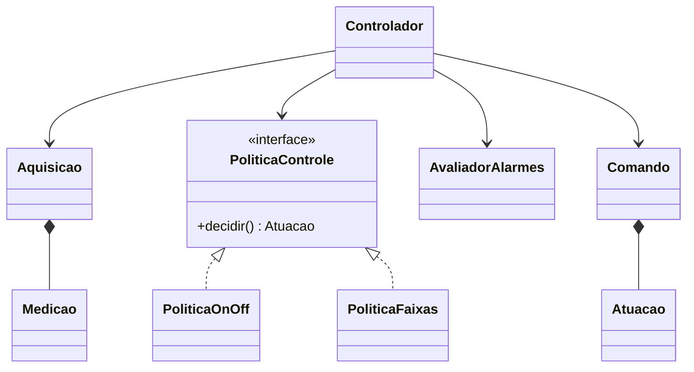

# Arquitetura — Controle e Supervisão de Tanque

## 1. Problema

Criar um sistema capaz de monitorar e controlar, de forma automática, o nível e a temperatura de um tanque, através de uma bomba de enchimento e um aquecedor.

## 2. Grandezas e atuadores

- Nível: LT-01, medido em %.
- Temperatura: TT-01, medida em C.
- Bomba: atuação entre 0% e 100%.
- Aquecedor: atuação entre 0% e 100%.

## 3. Objetivos de controle

Nível:
- Referência: 70%.
- Faixa desejada: 65% a 75%.

Temperatura:
- Referência: 30 °C.
- Faixa desejada: 28 °C a 32 °C.

## 4. Alarmes e estados

- NIVEL_CRITICO: nível < 5%.
- NIVEL_BAIXO: 5% <= nível < 20%.
- NIVEL_ALTO: nível > 90%.
- TEMP_BAIXA: temperatura < 22 °C.
- TEMP_ALTA: temperatura > 40 °C.

O nível crítico terá prioridade visual e será
apresentado em vermelho no supervisório.

Também haverá diagnóstico de aquisição ausente,
inválida ou obsoleta.

## 5. Estratégias de controle

Política 1 — ON/OFF com histerese:
- Bomba: liga abaixo de 65%, desliga a partir de 75%.
- Aquecedor: liga abaixo de 28 °C, desliga a partir
  de 32 °C.
- Entre os limites, mantém o estado anterior.

Política 2 — Controle por faixas:

Bomba:
- Abaixo de 5%: 100%.
- De 5% até abaixo de 50%: 70%.
- De 50% até abaixo de 70%: 50%.
- A partir de 70%: 0%.

Aquecedor:
- Abaixo de 22 °C: 100%.
- De 22 °C até abaixo de 26 °C: 70%.
- De 26 °C até abaixo de 30 °C: 50%.
- A partir de 30 °C: 0%.

## 6. Arquitetura

Planta Python:
- Simula as medições e responde aos atuadores.

Controlador C++:
- Valida aquisições.
- Executa uma política de controle.
- Envia comandos e acompanha confirmações.
- Produz telemetria e alarmes.

Supervisório Python/Streamlit:
- Apresenta medições, alarmes e gráficos.
- Registra histórico em SQLite.
- Permite exportação CSV.

A comunicação será realizada pelos arquivos JSON
definidos em docs/CONTRATO.md.

## 7. Padrões previstos

- Strategy: permite substituir políticas de controle.
- Command: organiza as solicitações e seus IDs.
- Repository: possibilidade para isolar o SQLite.

## 8. Limitações da simulação

A planta é uma simulação didática, sem calibração física.

A bomba aumenta o nível em até 3 pontos percentuais
por ciclo, enquanto o consumo retira aproximadamente
1 ponto percentual por ciclo.

O aquecedor aumenta a temperatura em até 1,5 °C
por ciclo. Sem aquecimento, a temperatura tende
a se aproximar de 20 °C.

A planta também possui perturbações pseudoaleatórias:
- Nível: de -0,2 a +0,2 ponto percentual por ciclo.
- Temperatura: de -0,1 a +0,1 °C por ciclo.

O sistema possui aquecimento, mas não possui
resfriamento ativo nem esvaziamento controlado.

Os snapshots JSON representam apenas o estado
mais recente e podem perder ciclos.

A atuação expira após cinco ciclos sem um novo
comando válido, conforme a configuração padrão.

Os limites de alarme são didáticos e não representam
limites de segurança de uma instalação industrial.

O prazo de obsolescência das aquisições ainda será
definido e documentado.

## 9. Modelagem orientada a objetos

A arquitetura do controlador será baseada em classes
com responsabilidades separadas.

- Medicao representa uma leitura validada.
- Aquisicao reúne as informações de um ciclo.
- Atuacao representa os percentuais dos atuadores.
- PoliticaControle define a interface das políticas.
- PoliticaOnOff implementa controle com histerese.
- PoliticaFaixas implementa controle por faixas.
- Comando representa solicitações identificadas.
- AvaliadorAlarmes avalia condições de alarme.
- Controlador coordena a aquisição, decisão e atuação.

### Diagrama de classes inicial

O diagrama é preliminar e será detalhado durante
a implementação, incluindo atributos, métodos
e tratamento de estados e falhas.