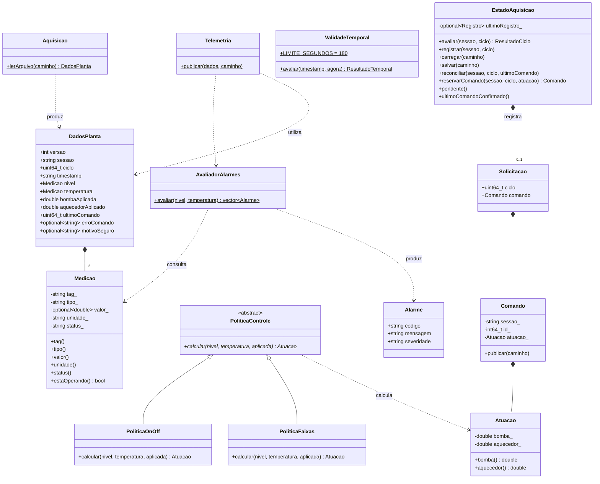
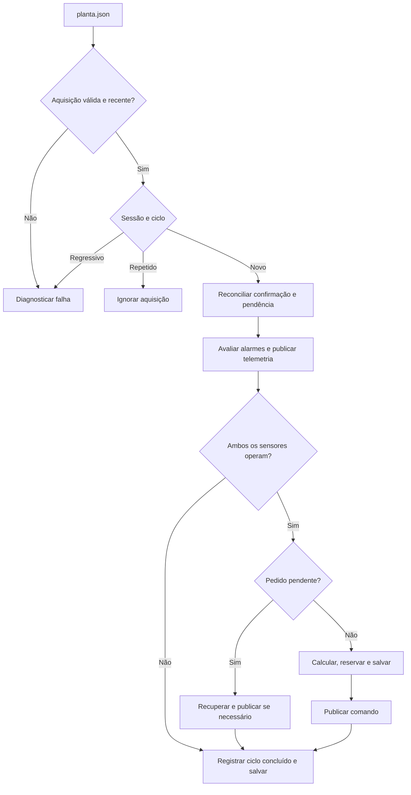

# Arquitetura — Controle e Supervisão de Tanque

## 1. Problema

Criar um sistema capaz de monitorar e controlar, de forma automática,
o nível e a temperatura de um tanque, através de uma bomba de
enchimento e um aquecedor.

## 2. Grandezas e atuadores

- Nível: LT-01, medido em %.
- Temperatura: TT-01, medida em C.
- Bomba: atuação entre 0% e 100%.
- Aquecedor: atuação entre 0% e 100%.

## 3. Objetivos de controle

Nível:
- Referência: 70%.
- Faixa desejada: 65% a 75%.

Temperatura:
- Referência: 30 °C.
- Faixa desejada: 28 °C a 32 °C.

## 4. Alarmes e estados

Alarmes publicados pelo controlador na Etapa 02

- NIVEL_CRITICO: nível < 5%.
- NIVEL_BAIXO: 5% <= nível < 20%.
- NIVEL_ALTO: nível > 90%.
- TEMP_BAIXA: temperatura < 22 °C.
- TEMP_ALTA: temperatura > 40 °C.

O nível crítico terá prioridade visual e será apresentado
em vermelho no supervisório.

O controlador já apresenta diagnóstico de aquisição ausente,
inválida ou obsoleta, além de identificar ciclos repetidos,
regressivos e reinícios da planta.

O campo `alarmes` é um array de objetos com `codigo`, `mensagem` e `severidade`.
`NIVEL_CRITICO` usa `critico`. Os demais usam `aviso`. Sem alarmes ativos,
o array é vazio. Um sensor em falha permanece na telemetria com `valor: null`.
O avaliador considera o outro sensor, se operacional, e o controlador não
publica comando naquele ciclo.

## 5. Estratégias de controle

Selecione a estratégia com `--politica on-off|faixas`. A opção padrão é `on-off`.

Política 1 — ON/OFF com histerese:

- Bomba: liga abaixo de 65%, desliga a partir de 75%.
- Aquecedor: liga abaixo de 28 °C, desliga a partir de 32 °C.
- Dentro da banda, incluindo o limite inferior, usa a potência que a planta
  informa como aplicada. Zero significa desligado e qualquer potência positiva
  significa ligado. Assim, uma potência parcial observada resulta em 100%
  dentro da banda. No limite superior, a saída já é 0%.

Política 2 — Controle por faixas:

Bomba:

- Abaixo de 5%: 100%.
- De 5% até abaixo de 50%: 70%.
- De 50% até abaixo de 70%: 50%.
- A partir de 70%: 0%.

Aquecedor:

- Abaixo de 22 °C: 100%.
- De 22 °C até abaixo de 26 °C: 70%.
- De 26 °C até abaixo de 30 °C: 50%.
- A partir de 30 °C: 0%.

## 6. Arquitetura

Planta Python:

- Simula as medições e responde aos atuadores.

Controlador C++:

- Lê e valida as aquisições.
- Identifica sessões e ciclos.
- Verifica a validade temporal dos dados.
- Persiste o último ciclo concluído e a última solicitação identificada.
- Publica a telemetria com os alarmes ativos.
- Calcula a atuação pela estratégia selecionada.
- Publica comandos e reconcilia sua aceitação com `ultimo_comando`.

Supervisório Python/Streamlit:

- Apresentará medições, alarmes e gráficos.
- Registrará histórico em SQLite.
- Permitirá exportação CSV.

A comunicação é realizada pelos arquivos JSON definidos
em docs/CONTRATO.md.

### 6.1. Arquivos de comunicação

| Arquivo | Responsabilidade |
|---|---|
| planta.json | Aquisição produzida pela planta. |
| telemetria.json | Dados validados publicados pelo controlador. |
| controlador_estado.json | Sessão, último ciclo concluído, ID confirmado e última solicitação, quando disponível. |
| comando_planta.json | Solicitação com versão, sessão, ID e percentuais dos dois atuadores. |

O controlador utiliza a biblioteca nlohmann/json para
leitura e escrita dos documentos JSON.

Telemetria, estado e comando são publicados
por meio de arquivos temporários, seguidos de renomeação,
evitando a exposição de documentos parcialmente escritos.

### 6.2. Modos de execução

O controlador possui dois modos de execução.

Execução única:

```bash
./build/controlador --dados dados --uma-vez
```

Realiza uma tentativa de aquisição e encerra sem esperar.

Execução contínua:

```bash
./build/controlador --dados dados
```

Realiza tentativas de aquisição com intervalo de um segundo.

## 7. Padrões implementados

- **Strategy**. `PoliticaControle` define a interface abstrata. O laço recebe
  uma referência à interface e o despacho virtual chama `PoliticaOnOff` ou
  `PoliticaFaixas` conforme a escolha da CLI.
- **Command**. `Comando` reúne sessão, ID e `Atuacao` e oferece `publicar()`.
  O arquivo é o canal para a planta, que valida e aplica o pedido antes
  de calcular um novo snapshot.

## 8. Limitações da simulação

A planta é uma simulação didática, sem calibração física.

A bomba aumenta o nível em até 3 pontos percentuais
por ciclo, enquanto o consumo retira aproximadamente
1 ponto percentual por ciclo.

O aquecedor aumenta a temperatura em até 1,5 °C
por ciclo. Sem aquecimento, a temperatura tende
a se aproximar de 20 °C.

A planta também possui perturbações pseudoaleatórias:

- Nível: de -0,2 a +0,2 ponto percentual por ciclo.
- Temperatura: de -0,1 a +0,1 °C por ciclo.

O sistema possui aquecimento, mas não possui
resfriamento ativo nem esvaziamento controlado.

Os snapshots JSON representam apenas o estado
mais recente e podem perder ciclos.

A atuação expira após cinco ciclos sem um novo
comando válido, conforme a configuração padrão.

Os limites de alarme são didáticos e não representam
limites de segurança de uma instalação industrial.

### 8.1. Validade temporal

O prazo de obsolescência das aquisições foi definido
em 180 segundos (3 minutos).

Aquisições com idade superior a 180 segundos ou com
timestamp no futuro são rejeitadas pelo controlador.

Esse limite foi escolhido considerando o ambiente
didático e a realização de testes manuais.

A validade temporal da aquisição é independente
do prazo de expiração da atuação, contado em ciclos.

### 8.2. Limitações da persistência

O estado aceita o formato legado com apenas `sessao` e `ciclo`. No formato
estendido, `ciclo: 0` representa uma sessão com estado de comando e sem ciclo
concluído. Os ciclos da planta continuam positivos. A última solicitação guarda
seu ciclo de origem, ID e percentuais. Esse arquivo registra somente a sessão
corrente e a última solicitação.

A reserva é persistida antes da publicação. Se a execução for interrompida, o
controlador recupera o pedido com o mesmo ID e percentuais. Se o JSON já contiver
o pedido recuperado, ele é mantido. A confirmação usa `ultimo_comando` da mesma
sessão. Um ID observado maior que o pendente encerra a pendência sem comprovar
a aceitação do pedido anterior. A troca de sessão descarta o estado da anterior.

Telemetria, comando e estado são publicados atomicamente por arquivo. O protocolo
de reserva protege a identidade do pedido entre escritas. Os três arquivos
não formam uma transação e a renomeação não garante durabilidade após queda
de energia.

## 9. Modelagem orientada a objetos

A arquitetura do controlador utiliza classes com
responsabilidades separadas.

### 9.1. Classes do controlador

| Classe ou estrutura | Responsabilidade |
|---|---|
| Medicao | Representar e validar uma medição da planta. |
| DadosPlanta | Agrupar as informações de uma aquisição validada. |
| Aquisicao | Ler e validar o arquivo planta.json. |
| EstadoAquisicao | Identificar sessões e ciclos, registrar e persistir o último estado processado. |
| ValidadeTemporal | Verificar a idade das aquisições. |
| Telemetria | Serializar e publicar o snapshot validado e os alarmes ativos. |
| Atuacao | Encapsular percentuais finitos entre 0 e 100. |
| PoliticaControle | Definir o cálculo polimórfico de atuação. |
| PoliticaOnOff | Calcular a atuação com histerese. |
| PoliticaFaixas | Calcular a atuação em quatro faixas. |
| Comando | Representar e publicar uma solicitação identificada. |
| AvaliadorAlarmes e Alarme | Avaliar as medições operacionais e representar condições ativas. |

A função main coordena a execução do controlador,
delegando as responsabilidades às classes implementadas.

### 9.2. Diagrama de classes — Etapa 02



### 9.3. Fluxo por aquisição



A planta confirma o pedido posteriormente no próprio snapshot. A telemetria
preserva a atuação observada, inclusive quando há um pedido aguardando resposta.

## 10. Validação da Etapa 01

A implementação foi verificada por meio dos testes
oficiais fornecidos pelo professor e dos testes
autorais desenvolvidos em C++.

Resultados:

- 15 testes oficiais aprovados.
- 7 executáveis autorais C++ aprovados.
- Cobertura de linhas C++: 85,9%.
- Cobertura de funções C++: 100%.
- Cobertura de ramificações C++: 48,5%.

Também foram realizadas verificações manuais da
persistência, identificação de ciclos repetidos,
reinício da planta, rejeição de ciclos regressivos,
validade temporal e execução contínua.

## 11. Validação da Etapa 02

O README registra os resultados oficiais, autorais e de cobertura. A integração
local executou ambos os processos separadamente para as duas políticas,
observou confirmações, expiração e reinícios e verificou falhas induzidas e
alarmes em snapshots controlados.
